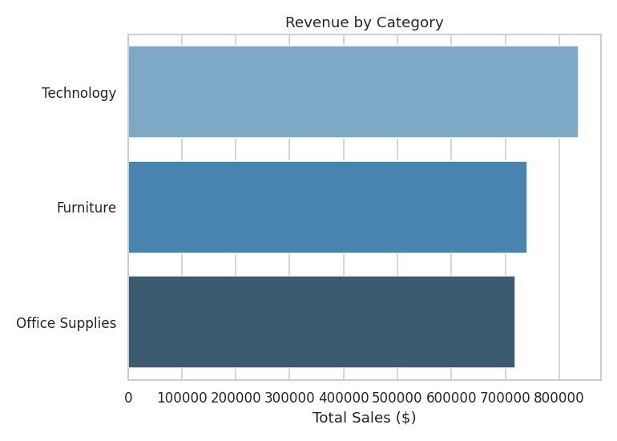
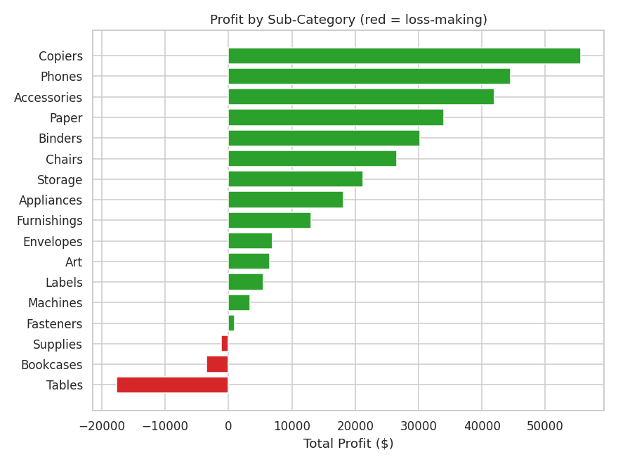
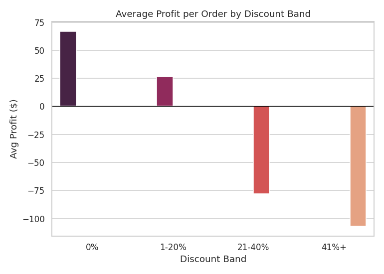
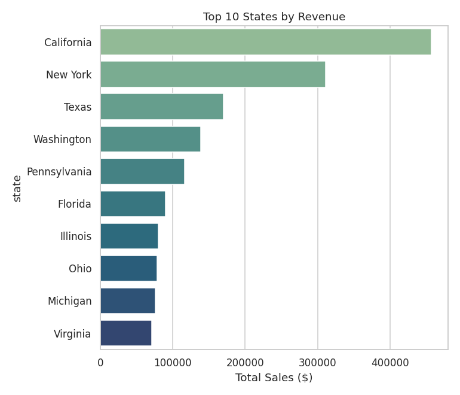
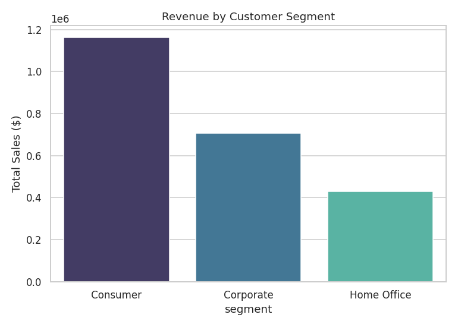
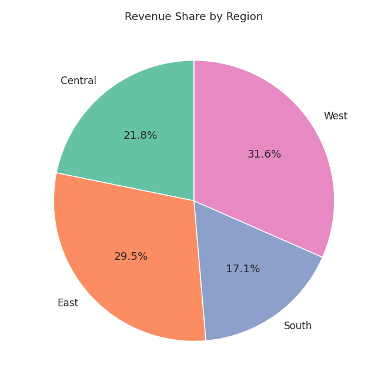
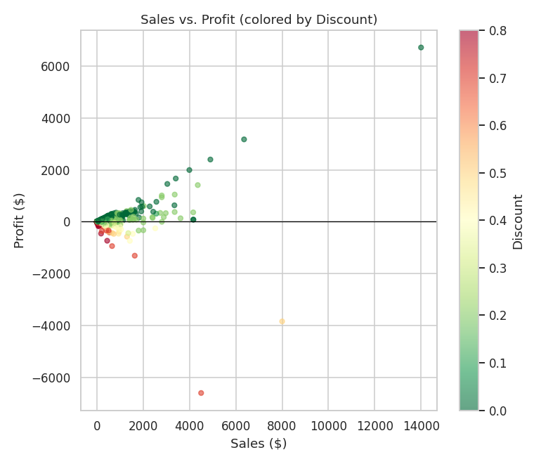
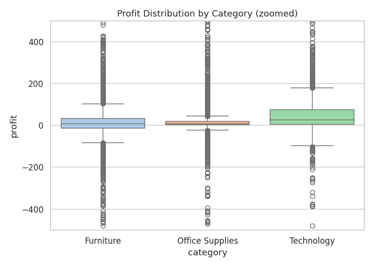
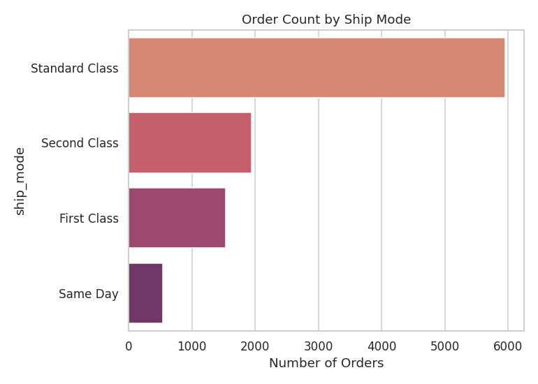
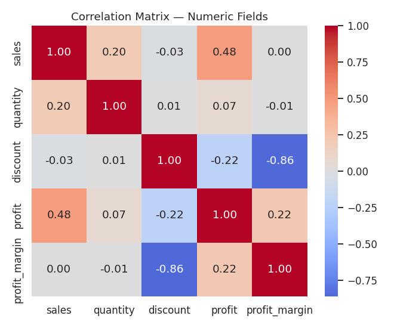

# Superstore Insights: Sales & Profitability Analytics

An end-to-end analytics project on the *Sample Superstore* retail dataset. It covers data cleaning, a normalized SQL schema, exploratory analysis in Python, a formula-driven Excel dashboard, an interactive HTML dashboard, and pricing recommendations. It answers one question: **where does this retailer make money, and where do discounts destroy it?**

> Featured in my portfolio as **Superstore Insights** (Analytics, 2026).

---

## Headline Results

| Metric | Value |
|---|---|
| Order lines analyzed | 9,977 (9,994 raw, 17 duplicates removed) |
| Revenue | $2.30M |
| Profit | $286K |
| Overall margin | 12.5% |
| Loss-making order lines | about 19% |

**The main finding:** revenue alone is misleading. Furniture brings in $741K but keeps only a 2.5% margin, while Technology and Office Supplies earn about 17%. Average profit per order turns negative once discounts pass about 20%.

---

## Business Problem

A retail analytics team could not see which categories, regions, and segments were profitable, or where heavy discounting was turning sales into losses. This project builds that view and turns it into pricing and merchandising decisions.

## Dataset

| Property | Value |
|---|---|
| Rows (raw / cleaned) | 9,994 / 9,977 |
| Columns | 13 raw, 17 after cleaning and feature engineering |
| Grain | One row per order line item |
| Geography | United States, 49 states, 531 cities |

**Raw columns:** Ship Mode, Segment, Country, City, State, Postal Code, Region, Category, Sub-Category, Sales, Quantity, Discount, Profit.

**Scope note:** the source extract has no order date, customer ID, seller, or payment fields. Rather than inventing them, every deliverable here is scoped to what the data supports: category, sub-category, geography, segment, ship mode, discount, and profitability.

---

## Repository Structure

```
Superstore-Dataset/
├── Data/
│   ├── Raw/
│   │   └── SampleSuperstore.csv.xlsx            # original extract
│   ├── Clean/
│   │   └── Clean.xlsx                           # cleaned + engineered dataset
│   └── Excel Analytics and Dashboard/
│       └── Dashboard_Clean_Data.xlsx            # 8-sheet Excel dashboard
├── Sql/
│   ├── create_tables.sql                        # normalized schema (PostgreSQL)
│   ├── import_data.sql                          # staging load + dimension/fact population
│   └── analysis_queries.sql                     # 15 analysis queries
├── Notebooks/
│   └── Superstore analysis.ipynb                # cleaning, EDA, findings
├── Visualizations/                              # 10 PNG charts
├── Dashboard/
│   └── Superstore_Dashboard.html                # interactive HTML dashboard
└── README.md
```

---

## Workflow

```
Raw data → Cleaning (pandas) → Clean.xlsx ─┬→ SQL schema + queries
                                           ├→ Excel dashboard
                                           ├→ Jupyter EDA notebook
                                           └→ PNG charts + HTML dashboard
```

### 1. Data cleaning
1. Standardized column names to `snake_case`.
2. Removed **17 exact duplicate rows**.
3. Stored `postal_code` as a zero-padded string, since the integer type stripped leading zeros on New England ZIPs.
4. Rounded money fields to 2 decimals and trimmed whitespace.
5. Validated `discount` in [0, 1] and `quantity` > 0. No invalid values were found.
6. Flagged, but did not remove, IQR outliers in `sales` and `profit`. They are real bulk or high-discount transactions, not errors.
7. Engineered `profit_margin`, `unit_price`, and `is_loss_making`, and added a surrogate `record_id`.

### 2. SQL database
A normalized schema built around the dimensions the data supports: `dim_location`, `dim_product`, `dim_ship_mode`, `dim_segment`, and a `fact_sales` table. `analysis_queries.sql` covers sales, product, segment, shipping, discount, and KPI analysis, including discount bands vs. profit and loss-making orders by category.

### 3. Exploratory analysis
The notebook walks through data quality checks, descriptive statistics, correlations, category and sub-category performance, loss-making products, discount vs. profitability, geography, and segment and shipping analysis.

### 4. Excel dashboard
`Dashboard_Clean_Data.xlsx` has 8 sheets: Executive Dashboard, Revenue Analysis, Segment Analysis, Product Analysis, Shipping Analysis, Discount Analysis, Raw Data, and Clean Data.

### 5. HTML dashboard
`Dashboard/Superstore_Dashboard.html` is a self-contained interactive dashboard. Blue marks healthy profit and orange marks loss or risk. Open it directly in a browser.

---

## Key Findings

**By category**

| Category | Revenue | Profit | Margin |
|---|---|---|---|
| Technology | $836K | $145K | 17.4% |
| Office Supplies | $719K | $122K | 17.0% |
| Furniture | $741K | $18K | 2.5% |

**Where the losses are**
- **Tables** lose $17.7K (-8.6% margin) and **Bookcases** lose $3.5K, and both are net loss-making. **Supplies** also loses money (-$1.2K).
- Discounts above 20% push average profit per order negative:

| Discount band | Avg profit per order |
|---|---|
| None | +$67.02 |
| 10-20% | +$24.76 |
| 20-30% | -$45.83 |
| 30-40% | -$109.22 |
| 40-50% | -$298.70 |

- Discount has almost no correlation with sales volume (r = -0.03), but a negative one with profit (r = -0.22).

**Geography**
- **West** (14.9% margin) and **East** (13.5%) lead. **Central** is weakest at 7.9%.
- California ($458K) and New York ($311K) are the top states by revenue. Several large states lose money despite high revenue: **Texas (-$25.8K)**, **Ohio (-$17.0K)**, **Pennsylvania (-$15.6K)**, and **Illinois (-$12.6K)**.

**Segment and shipping**
- **Consumer** leads revenue ($1.16M) but has the lowest margin (11.5%). **Home Office** has the highest (14.0%).
- **Standard Class** handles most orders (5,955 of 9,977).

---

## Visualizations

| | |
|---|---|
|  |  |
|  |  |
|  |  |
|  |  |
|  |  |

---

## Business Recommendations

1. Cap Furniture discounts at around 20% pending a pricing review.
2. Re-price or drop chronically loss-making Tables and Bookcases.
3. Require manager approval for discounts above about 30%.
4. Shift promotional budget toward Technology and Office Supplies.
5. Investigate why Texas, Ohio, Pennsylvania, and Illinois lose money despite high revenue.
6. Test bundling instead of blanket discounting to lift volume without losing margin.
7. Close the Central and South revenue gap with targeted campaigns.
8. Collect shipping-cost data so ship modes can be judged on profit, not order count.
9. Capture timestamped transactions to enable trend and seasonality analysis.

---

## Tech Stack

- **Python:** pandas, numpy, matplotlib, seaborn, Jupyter
- **SQL:** PostgreSQL syntax
- **Excel:** formula-driven dashboard (SUMIF, COUNTIF, AVERAGEIF)
- **HTML/CSS/JS:** interactive dashboard

## How to Run

```bash
git clone https://github.com/jamesloydtapdasan-beep/Superstore-Dataset.git
cd Superstore-Dataset
pip install pandas numpy matplotlib seaborn jupyter openpyxl
jupyter notebook "Notebooks/Superstore analysis.ipynb"
```

- **Dashboard:** open `Dashboard/Superstore_Dashboard.html` in any browser.
- **Excel:** open `Data/Excel Analytics and Dashboard/Dashboard_Clean_Data.xlsx`.
- **SQL (optional):** export `Data/Clean/Clean.xlsx` to CSV at `Data/Cleaned/superstore_clean.csv` (the path `import_data.sql` expects), then run:

```bash
psql -f Sql/create_tables.sql
psql -f Sql/import_data.sql
psql -f Sql/analysis_queries.sql
```

## Limitations and Future Work

- No dates or customer IDs, so there is no trend, seasonality, or retention analysis yet.
- No shipping cost, so ship-mode profitability cannot be assessed.
- Planned: add timestamped orders, build a live Power BI or Tableau dashboard on the SQL schema, and convert the Excel summaries to native PivotTables.

## Author

**JL**, CS student at Cebu Technological University, Naga Extension Campus. Built as a portfolio and capstone-style analytics project.
